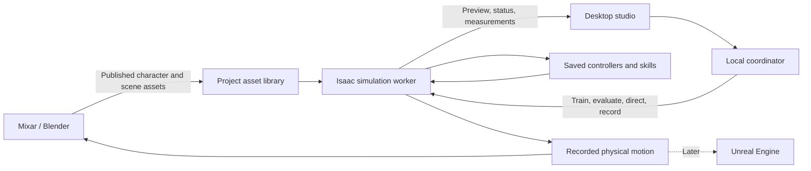

# Digital Human Research Studio — Implementation Plan

> Execution scope: Milestone 0 only, per the current user request. The workspace was renamed to `/home/vincent/Repos/DigitalHumanStudio`. Historical machine observations below are superseded by `docs/SETUP_REPORT.md`; later milestones remain unstarted.

## 1. Goal, scope, and starting conditions

Build a **local Linux desktop studio** in which you can:

- Open and refine a realistic virtual human in **Mixar/Blender**.
- Train physics-based movement using **Isaac Sim, Isaac Lab, and ProtoMotions**.
- Direct the character live.
- Save skills, compare versions, and test performance under changed conditions.
- Record performances for later rendering.

The first completed version will include **walking to a destination, turning, stopping, and a separately learned crouch-and-rise skill**. Crouching is the proposed second skill because it tests repertoire growth without immediately adding furniture, ladders, or object manipulation.

Unreal presentation and an embedded conversational assistant follow after this version. Restaurant and theater simulations remain possible applications, with no business domain built into the initial studio.

**Confirmed preferences:** a working research studio, Linux desktop interface, free-first assets, and local compute.

**Inspected environment:**

| Item | Current state |
|---|---|
| GPU | NVIDIA RTX PRO 6000 Blackwell, approximately 96 GB VRAM |
| System memory | 121 GiB |
| Free storage | Approximately 3.4 TB |
| Operating system | Ubuntu 26.04.1 |
| Workspace | `/home/vincent/Repos/DigitalHumanStudio`, currently empty |
| Development tools | Python present; Git, Docker, Blender, Node, and uv not found on the command path |

The principal setup uncertainty is OS compatibility: NVIDIA currently lists Ubuntu 22.04/24.04 for Isaac Sim. An isolated runtime can address dependency differences, but does not establish host-driver compatibility. That requires an early test. [Isaac Sim requirements](https://docs.isaacsim.omniverse.nvidia.com/latest/installation/requirements.html)

This is a staged implementation specification. Learning quality and cross-application compatibility remain experimental outcomes; failed milestones must produce evidence rather than a misleading completion claim.

## 2. Systems and technical approach

### Proposed software stack

| System | Implementation choice and responsibility |
|---|---|
| Desktop studio | Python 3.12 with PySide6: project controls, live preview, skill library, training status, and results |
| Local coordinator | Python service using FastAPI, with local HTTP commands and WebSocket updates |
| Physical simulation | Isaac Sim through Isaac Lab; sole authority for physical state |
| Human learning | ProtoMotions, using a supported SOMA human body and pretrained movement foundation |
| Character authoring | Mixar’s Linux distribution, using its Blender-based editing and scripting capabilities |
| Visual human foundation | Native SOMA body assets, refined in Mixar; fixed proportions for the first version |
| Project records | SQLite for searchable metadata; ordinary files for assets, recordings, and checkpoints |
| Runtime isolation | GPU-enabled container for the simulation stack; separate environment for the desktop application |
| Later presentation | Unreal Engine, initially receiving recorded movement |
| Later conversational control | An assistant calling the same studio commands as the visual interface |

PySide6 provides the desktop application framework. [Qt for Python](https://doc.qt.io/qtforpython-6/)

### Dependency baseline

Use the following as the initial reproducible baseline:

- ProtoMotions revision `f69fdcaabff31846b4d2247207417b57dc788828`, inspected during planning.
- Its documented Isaac Lab source revision `4ecd0b036da19ff6ad2bb4d621f886b63e9f6db8`, paired with Isaac Sim 6.0 and Python 3.12.
- Mixar Linux release **4.3.5**, available during inspection.
- SOMA-X **0.3.4** for native body assets, subject to the skeleton-mapping test below.

Record package locks, downloaded asset hashes, and container image digests during setup. Do not independently upgrade components after establishing the working baseline. ProtoMotions explicitly documents a pinned Isaac Lab workspace. [Installation instructions](https://nvlabs.github.io/ProtoMotions/getting_started/installation.html)

### How the systems connect

The simulator owns body positions, collisions, and contact responses. The visual character follows the simulated body. Clothing, hair, and skin detail initially affect appearance only.

Keep the supported physical body’s proportions, joint ordering, gains, and control timing intact. Map its movement onto the detailed visual skeleton. SOMA’s visual skeleton and ProtoMotions’ simplified physical body must be explicitly mapped; their shared name does not establish interchangeability.

### Integration interfaces

Define a small, versioned internal interface:

- **Project operations:** open project, register assets, publish character, inspect compatibility.
- **Job operations:** train, evaluate, cancel, resume, retrieve results.
- **Live operations:** start session, set destination, stop walking, crouch, rise, pause simulation, reset, record.
- **Events:** job state, progress, metrics, preview frames, errors, and recording completion.

Use stable identifiers for characters, scenes, skills, and runs. Every saved skill records its required body, simulator baseline, controller settings, and parent checkpoint.

Use metres and a Z-up coordinate system internally. Exported recordings include timestamps, root movement, joint names, and local joint rotations. Conversion belongs in application adapters.

The coordinator binds to localhost. Simulation and training run in separate worker processes so a crashed worker does not close the studio. Only one heavy GPU job runs at a time.

## 3. Implementation milestones

### Milestone 0 — Establish a reproducible runtime

**Work**

- Initialize the project and Git history in the current empty workspace.
- Add project instructions, this implementation specification, and a persistent milestone log.
- Install the required development and GPU-container tooling.
- Establish the pinned Isaac/ProtoMotions environment in a container with Ubuntu 24.04 userspace.
- Install Mixar from its Linux binary distribution.
- Record component versions, asset provenance, and required account or license steps.
- Run GPU, physics, rendering, and Mixar save/reopen checks.

**Completion evidence**

A repeatable launcher can start the simulation, render a scene, and open a saved Mixar project. The setup report records the actual working configuration.

**Failure rule**

If the Ubuntu 26.04 host cannot reliably run the stack, stop this milestone with diagnostic evidence and a concrete supported-environment recommendation. Do not reinstall the OS or change the research stack automatically.

### Milestone 1 — Reproduce a physical human baseline

**Work**

- Load the supported SOMA 23-body humanoid.
- Run ProtoMotions’ recommended Isaac Lab motion tracker against its matching bundled sample motions.
- Verify joint mapping, contacts, timestep, controller settings, and asset loading.
- Record complete trials and failures.
- Load the compatible GPC movement prior as the starting point for task learning.

The motion tracker follows reference motion; it does not independently choose destinations. The GPC prior is a reusable movement foundation, also requiring task adaptation. Keep these distinctions visible in the studio. [Tracker model card](https://github.com/NVlabs/ProtoMotions/blob/main/data/pretrained_models/motion_tracker/soma-bones/MODEL_CARD.md), [GPC model card](https://github.com/NVlabs/ProtoMotions/blob/main/data/pretrained_models/gpc_prior/soma_bones/MODEL_CARD.md)

**Completion evidence**

A repeatable baseline runs without invalid physical states, configuration mismatches, or missing assets. Its measurements and video are saved.

This milestone proves the environment works; it does not count as newly acquired skill.

### Milestone 2 — Connect the detailed character

**Work**

- Create one generic adult character using native SOMA assets and Mixar editing.
- Preserve the physical body’s proportions.
- Add skin materials, eyes, simple hair, and close-fitting clothing.
- Build an explicit physical-body-to-visual-skeleton mapping.
- Publish the visual character and simple room through a scripted export.
- Load the character into Isaac for live presentation.
- Import recorded physical poses back into Mixar for replay and rendering.

Use native SOMA assets rather than introducing separately licensed SMPL-family assets. SOMA supports native body representations; optional third-party model inputs retain separate requirements. [SOMA model overview](https://nvlabs.github.io/SOMA-X/latest/model_card.html)

Mixar documents free scene editing and an external AI connection through MCP. Paid generation is optional. Use its supported scripting/export workflow for repeatable publishing; enable AI assistance through an existing connection only when available. [Mixar documentation](https://www.mixar.app/docs)

**Completion evidence**

The same recorded performance can drive the detailed character in Isaac and Mixar without changed proportions, broken joints, or accumulating root-position drift.

Visual acceptance is at normal full-body viewing distance. Close-up facial performance, dynamic cloth, and film-quality skin are outside this version.

### Milestone 3 — Train destination-directed walking

**Work**

- Start from ProtoMotions’ documented GPC task-adaptation approach.
- Freeze the shared movement foundation and train a separate walking adapter.
- Begin with the existing target-reaching experiment, adding explicit upright walking, slowing, stopping, and standing objectives.
- Train in a simple flat room with destinations 1–5 metres away.
- Vary starting position, heading, destination, and floor friction within declared training ranges.
- Include destination changes during movement.
- Introduce mild horizontal disturbances after basic walking succeeds.
- Evaluate the unadapted baseline and trained controller on the same reserved scenarios.

ProtoMotions provides task-adaptation examples using supervised initialization and reinforcement learning. These are foundations for the work, not proof that our selected task will converge unchanged. [GPC task adaptation](https://nvlabs.github.io/ProtoMotions/user_guide/gpc.html)

**Live controls**

A top-down room view selects the destination. Separate buttons provide:

- **Stop walking:** request a balanced stop.
- **Pause:** freeze simulated time.
- **Reset:** explicitly return to the starting state.

No invisible reset or teleportation may be used to hide failure.

**Training limits**

Use one GPU job at a time. Begin with a short throughput test, then cap each training attempt at eight hours. Allow up to three seeds per skill under a fixed recipe. Preserve checkpoints and report failure if the acceptance gate is not reached; do not launch an unlimited tuning search.

### Milestone 4 — Add a second skill and test retention

**Work**

- Train a separate crouch-and-rise adapter using the same frozen movement foundation.
- Target a modest crouch, approximately 15% below normal standing pelvis height.
- Require a controlled hold followed by a return to standing.
- Save the walking and crouching adapters independently.
- Introduce a simple sequence: walk → stop → crouch → rise → walk.
- Permit switching only after the character reaches the tested standing condition: low root velocity and stable support for one second.
- Include terminal states from the preceding skill in transition training and evaluation.

Do not assume that independently successful skills switch safely. Failed transitions are recorded as failures.

**Completion evidence**

The character can use both skills in one session, and the original walking evaluation still passes after the new skill is added.

This demonstrates an expandable skill library. It does not establish unlimited continual learning inside one model.

### Milestone 5 — Assemble the desktop studio

Build the interface around the proven operations:

| View | User-facing capability |
|---|---|
| Project | Open project, inspect dependencies, launch Mixar |
| Character | Preview visual/physical bodies and publish revisions |
| Skills | Browse controllers, capabilities, compatibility, and results |
| Training | Start bounded jobs, inspect progress, cancel, resume |
| Live scene | Direct the character, switch supported skills, record |
| Evaluation | Compare versions and inspect successful and failed trials |

Display Isaac-rendered preview frames inside the desktop application. Use a simple local frame stream initially, with a target of 30 frames per second at 720p. Keep recording and physical timing independent of preview frame delivery.

Recordings contain actual simulated poses and commands. Replaying those poses is the authoritative visual replay; rerunning physics is a separate operation and is not assumed to reproduce every frame exactly.

If Mixar editing changes the physical skeleton or proportions, publish a new incompatible character version. Appearance-only changes may reuse the controller after passing the mapping check.

## 4. Tests, acceptance criteria, and failure handling

The following are **proposed acceptance targets, not promised performance**.

| Area | Acceptance test |
|---|---|
| Runtime | Repeatable startup, simulation, rendering, shutdown, and restart |
| Walking | At least 90 successful trials out of 100 reserved flat-floor trials |
| Arrival | Reach within 0.3 m of the target within 15 seconds, then remain below 0.15 m/s for two seconds without falling |
| Live redirection | At least 90/100 trials succeed after one destination change |
| Crouching | At least 90/100 trials lower, hold for two seconds, and return to standing without falling |
| Skill sequence | At least 90/100 complete walk–crouch–walk trials |
| Retention | Walking success drops by no more than five percentage points after adding and integrating crouching |
| Visual mapping | Static root/foot mapping error within 2 cm; no accumulating replay drift over a 60-second recording |
| Interactivity | Real-time simulation, approximately 30 fps preview, and 95th-percentile command acknowledgement below 200 ms |
| Persistence | Reopening a project restores assets, controller selections, completed results, and recoverable job state |

Measure success across three training seeds, and report the distribution rather than only the best run. Keep training, development evaluation, and final acceptance scenarios distinct.

For disturbance testing, use reproducible horizontal impulses equivalent to a 0.1 m/s change in whole-body velocity. Report recovery separately; do not generalize this result to arbitrary pushes.

Also test:

- Missing assets and incompatible controller/body combinations.
- Training interruption and checkpoint resume.
- Worker crash, GPU-memory exhaustion, and preview disconnection.
- Out-of-bounds destinations.
- Falls during live use.
- Character export and reimport.
- Material changes that should not alter physical behavior.

A fall ends the scored attempt. The studio preserves the evidence and offers an explicit reset. A worker crash preserves the last complete checkpoint and marks the run interrupted. Incompatible assets are rejected before launching a job.

Each milestone delivers source changes, reproducible commands, a short result report, and relevant recordings. A failed research gate remains failed until evidence supports changing that status.

## 5. Delivery order, later expansion, and thread recommendation

**Delivery order**

1. Runtime compatibility.
2. Reproduced physical baseline.
3. Detailed character transfer.
4. Learned walking with live direction.
5. Second skill and retention.
6. Desktop studio integration and complete acceptance run.

Keep a working demonstration at every completed milestone. Training throughput measured early will inform scheduling; no reliable total-duration estimate exists yet.

**Later expansion**

- **Unreal:** first import recorded performances; then test live pose delivery while Isaac remains the physics authority.
- **Conversational studio control:** connect an assistant to the established command interface. It coordinates tasks; the trained controller handles movement.
- **Additional skills:** sitting, carrying, push-ups, and ladders, each with its own contact and generalization tests.
- **Operational simulation:** introduce arrival patterns, service times, decision rules, and validation data only after selecting a use case.
- **Multiple characters:** measure throughput and interaction behavior before committing to crowd-scale simulation.

These are follow-on directions, not part of the first version’s completion criteria.

**Start implementation in a fresh thread in the same project folder.** Keep this thread for design discussion. Give the new thread the complete plan; do not rely on it inferring the decisions from earlier conversation.

At the start of implementation, persist the specification as `IMPLEMENTATION_PLAN.md` and progress as `PROGRESS.md`. Subsequent threads should read both before changing anything. A separate Git worktree is unnecessary for the initial single implementation stream; worktrees become useful for independent changes once a Git repository exists. [Official worktree guidance](https://learn.chatgpt.com/docs/environments/git-worktrees)

Suggested opening message for the implementation thread:

> Implement the attached Digital Human Research Studio plan in `/home/vincent/Repos/DigitalHumanStudio`. Start with Milestone 0 and proceed in milestone order, recording evidence in the project. Use the local GPU and free-first dependencies. Preserve the host OS and stop at any failed compatibility or research gate with a concrete diagnosis. Do not expand into Unreal, an embedded conversational assistant, paid services, or business simulations during the first version.

No software has been installed and no project files have been written during this planning work.
