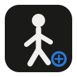
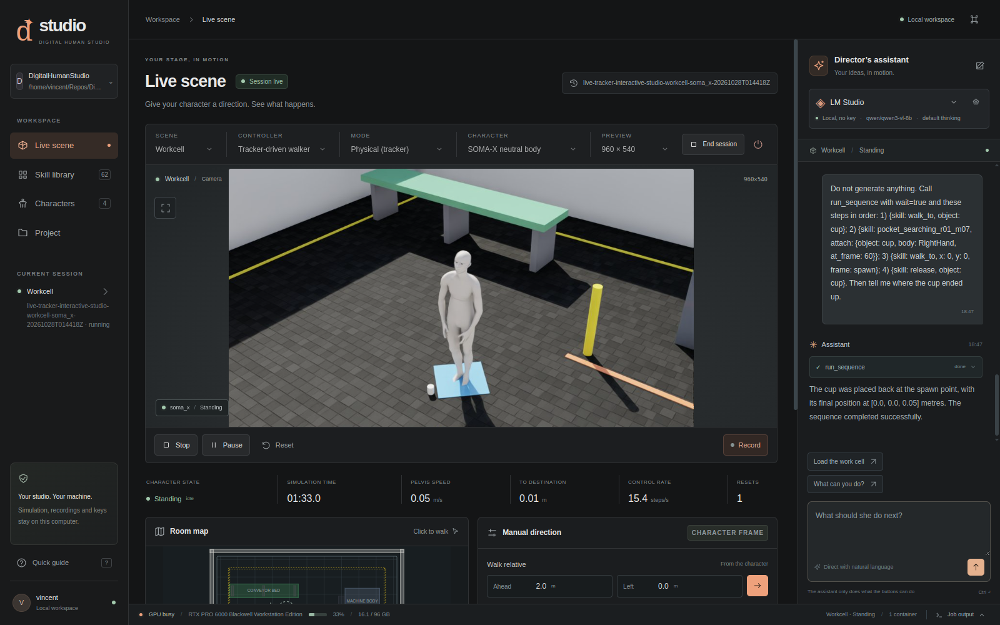
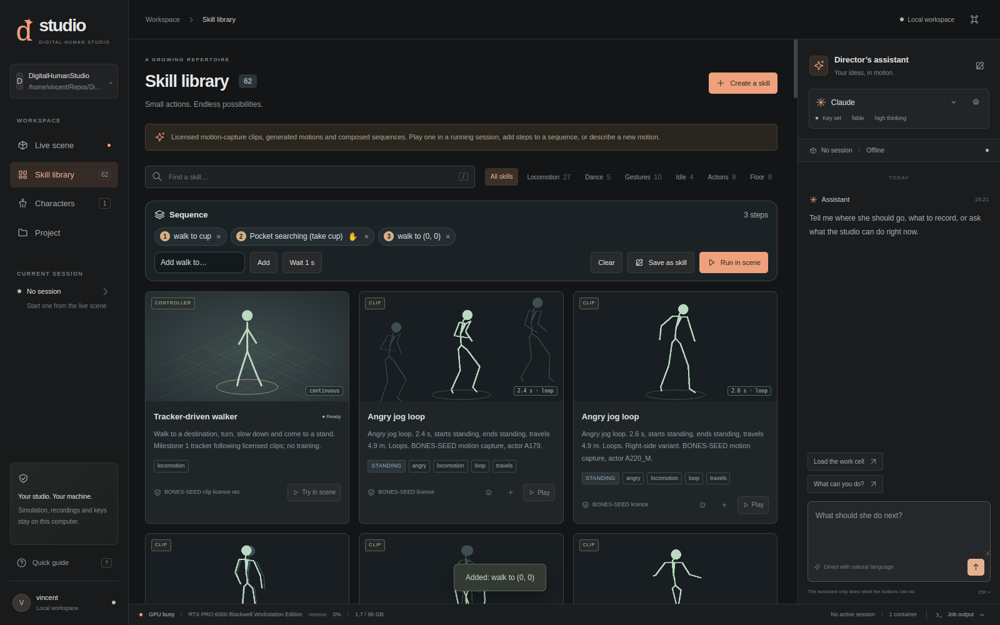
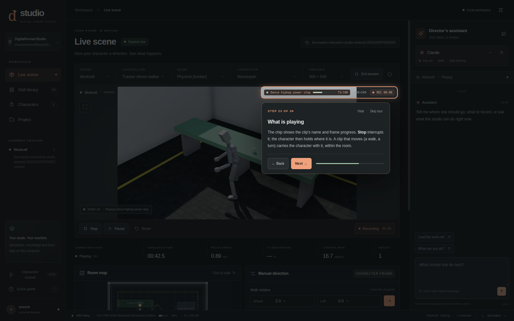

<div align="center">
  
  <h1>Digital Human Studio</h1>
  <p><strong>Give your character a direction. Build a performance.</strong></p>
  <p>A local Linux studio for directing virtual humans with AI,<br>composing reusable skills, and turning words into motion.</p>
  <p>
    <a href="LICENSE"></a>
    
    
    
    
  </p>
  <p>
    <a href="#see-it-in-action">Screenshots</a> ·
    <a href="#what-you-can-do">Features</a> ·
    <a href="#run-it-locally">Run locally</a> ·
    <a href="docs/CONTROL_CENTER.md">Studio guide</a> ·
    <a href="#licenses-and-credits">Licenses</a>
  </p>
</div>



Pick a character. Put them in a scene. Give them a direction. Then turn the result into something you can play again.

Digital Human Studio brings a live 3D scene, a motion library, a sequence composer, and an AI director's assistant into one desktop workspace. Walk to a point, play a dance, carry a prop through a sequence, or generate a new movement from text. Save the sequence as a skill and use it in the next performance.

Simulation and motion generation run on your machine. The assistant can use **LM Studio locally**, or a cloud provider you choose and configure.

## What you can do

| Capability | In the studio |
|---|---|
| **Direct by chat or by hand** | Ask the assistant to operate the studio, or use the same scene controls yourself. Watch the tool calls and the resulting action. |
| **Build a repertoire** | Browse a catalog of 61 BONES-SEED motion-capture clips, plus generated motions and saved sequences. Inspect each skill's source, terms, duration, and movement. Motion data has its own eligibility requirements. |
| **Compose a performance** | Chain walking, clips, waits, and prop interactions. Run the sequence in the scene, then save it as a reusable skill. |
| **Turn text into motion** | Generate clips locally with NVIDIA Kimodo, convert them to the studio's skeleton, and add them to the library. Model setup is separate. |
| **Choose how motion plays** | Use physical tracking for a simulated body, or kinematic playback for direct pose playback. Switch modes when starting a session. |
| **Bring a character to the stage** | Use prepared SOMA-X, Quaternius, Cesium Man, and KayKit rigs with recorded sources and skeleton mappings. |
| **Keep the take** | Mark recordings and keep video, command events, motion traces, and a session summary together. |
| **Learn inside the app** | A 36-step interactive tutorial takes you through a real session: walking, skills, sequences, recording, and the assistant. |

## See it in action

### A motion library that becomes your workflow

Search by category, inspect a clip, add it to a sequence, and save the whole performance as a skill. The sequence below walks to a cup, plays a clip with a timed attachment, and walks back.



### Learn by doing

The built-in tutorial highlights real controls and advances when the studio sees the action complete. Hide it, resume it, or use its “Do it for me” action.

<details>
<summary><strong>See the interactive tutorial</strong></summary>



</details>

These screenshots come from recorded development sessions. Their character selections and library counts reflect those sessions; the catalog continues to grow.

## Your first performance

Once the runtime and assets are prepared:

1. Open **Live scene**, choose the **Workcell**, a character, and a playback mode. Start a session.
2. Click a clear point on the room map to walk there. **Stop**, **Pause**, and **Reset** are separate controls.
3. Open **Skill library**, choose a motion, and play it. Kinematic playback is useful for exploring clips without falls.
4. Add a walk, a clip, and a wait to the sequence composer. Run it, then **Save as skill**.
5. Mark a recording, finish the performance, and use **End session** so the launcher can finalize the recording and session checks.

The assistant uses these same operations. Try asking it to list the available dance skills, play a named clip, or explain the current scene. Complex directions depend on the selected model's ability; the controls and command log remain available throughout.

## Run it locally

**This is a research prototype with a substantial local GPU stack.** It is not a one-command install or a hosted web app. The repository includes studio code, configuration, asset records, and diagnostic evidence. Large model weights, downloaded rigs, caches, and the built simulation image are not included.

### Get the source and inspect your machine

```bash
git clone https://github.com/VincentAZ/DigitalHumanStudio.git
cd DigitalHumanStudio
python3 scripts/inspect_host.py
```

The inspection writes a local machine report under `diagnostics/`. Read the [setup report](docs/SETUP_REPORT.md) before installing host tooling or building the runtime. It records the source pins, compatibility patches, package lock, validation steps, and setup limitations.

| Requirement | Current baseline |
|---|---|
| Desktop | Linux x86_64 with a Wayland or X11 session |
| GPU runtime | NVIDIA RTX GPU and a compatible driver; Docker with NVIDIA Container Toolkit |
| Simulation | Pinned Isaac Sim 6.0 / Isaac Lab / ProtoMotions stack in an isolated container |
| Studio interface | Project-local Python 3.12 and PySide6 / Qt WebEngine |
| Assets | Separately prepared weights, motion data, and character rigs with their applicable terms |

The recorded working host uses Ubuntu 26.04.1, an RTX PRO 6000 Blackwell with about 96 GB VRAM, and 121 GiB RAM. **That is the tested machine, not a published minimum requirement.** The setup report distinguishes the tested host from upstream-supported configurations. A clean rebuild from an empty cache has not been validated.

### Open the prepared studio

After following the setup report and preparing the pinned runtime and assets:

```bash
scripts/studio.sh
```

The launcher creates the interface's isolated environment when needed. Optional desktop integration:

```bash
scripts/install_desktop_launcher.sh
```

See the dedicated guides for [characters](docs/CHARACTERS.md), [motion generation](docs/MOTION_GENERATION.md), [the skill format](skills/README.md), and [studio controls](docs/CONTROL_CENTER.md).

## Your assistant, your choice

Choose **LM Studio**, **Claude**, **OpenAI**, **Google Gemini**, **xAI Grok**, or **OpenRouter**. LM Studio connects to your local server. Cloud providers use your own account and credentials, and their charges apply.

Provider settings are stored outside the repository at `~/.config/digital-human-studio/providers.json`; environment variables are also supported. A provider is called when you configure it and send a message. Choosing a cloud provider sends conversation and tool context to that provider. Local assistant transcripts and tool calls are saved with the project artifacts.

## Two ways to move

| Mode | What happens | Useful for |
|---|---|---|
| **Physical tracking** | A pretrained tracker follows a composed motion reference while the simulator controls the body. Contacts and falls matter. | Testing a performance in the physical scene. |
| **Kinematic playback** | The composed reference directly supplies the poses. It does not model contact or balance. | Inspecting clips, staging sequences, and previewing movement. |

The default walker composes existing walking, stopping, and idle motion. It does not train a new controller for each destination. Earlier reinforcement-learning walking experiments did not reach their acceptance target and remain archived in `sandbox/rl-training/`.

## Status and practical limits

The runtime baseline and motion-tracker reproduction have recorded passing evidence. Live direction, the library, composition, skinned characters, generated clips, and the tutorial have recorded development sessions in [PROGRESS.md](PROGRESS.md). This README update does not constitute a new runtime test.

- **Props attach at a chosen frame.** Grasping is a kinematic attachment, not contact-based finger manipulation.
- **Walking does not plan around obstacles.** Choose clear destinations and routes.
- **Physical clips can fall.** Floor work and acrobatics may need kinematic playback; physical sessions report falls and require an explicit reset.
- **Different rigs have different proportions.** Retargeted hands and feet may not align exactly with the physical body.
- **One heavy GPU job at a time.** End a live session before generating a new skill.
- **Text-to-motion has separate prerequisites.** Its Llama 3 text encoder has additional terms; the pending license decision is documented in the [generation guide](docs/MOTION_GENERATION.md).
- **Preview speed depends on the worker.** Recordings are timed at 30 fps of simulated time; the live preview is not a guaranteed 30 fps stream.

## Inside the project

```text
scripts/studio_app/         Desktop shell, web interface, and Qt bridge
scripts/studio_assistant/   Provider adapters and studio tools
scripts/studio_walk/        Motion composition, tracking, and character skinning
skills/                    Skill metadata, thumbnails, and saved sequences
config/scenes/             USD scenes, footprints, and prop definitions
config/                    Source pins, package locks, and asset records
docs/                      Setup, controls, characters, and model documentation
diagnostics/               Recorded checks and session evidence
sandbox/                   Retired experiments and interface prototypes
```

Simulation workers run separately from the desktop window. The assistant, buttons, and sequencer use the same recorded command interface. Skills and sequences are ordinary project files, so you can inspect how a performance is assembled.

## Contribute

[Open an issue](https://github.com/VincentAZ/DigitalHumanStudio/issues) with the behavior you expected, what happened, and the relevant commands and exit codes. Useful contributions include setup reproducibility, skeleton mappings, documented motion sources, and authoring controls.

Keep credentials and large generated assets out of Git. Preserve source pins and provenance, and distinguish a missing prerequisite from a failed test. See [AGENTS.md](AGENTS.md) for project constraints and [the direction document](docs/DIRECTION.md) for the current scope.

## Licenses and credits

**The original application code is free and open source under the [MIT License](LICENSE).** Use it, modify it, share it, or build a business with it. Keep the copyright and permission notice with copies or substantial portions of that code.

The MIT grant covers Vincent Serpico's original code and documentation; it does not relicense third-party code, models, model weights, motion data, character rigs, textures, or other assets, including those shown in screenshots. Those materials and dependencies keep their own terms and notices. BONES-SEED motion data has eligibility conditions, and Kimodo's text encoder uses the Meta Llama 3 Community License. Review the [component provenance](docs/PROVENANCE.md), [character credits](docs/CHARACTERS.md), [motion-generation notes](docs/MOTION_GENERATION.md), and each skill's source and license metadata before reuse or distribution.

Built on the work of NVIDIA Isaac Sim, Isaac Lab, ProtoMotions, SOMA-X and Kimodo; Bones Studio; the credited character creators; and the Qt for Python ecosystem.
