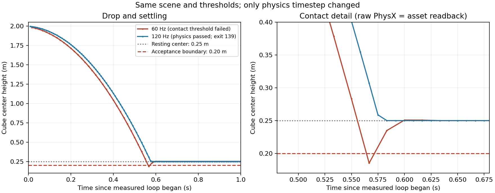

# Contact trajectory diagnosis — 2026-10-26

The 60 Hz floor-penetration failure is simulation timestep sensitivity, not disagreement between the cached asset position and the raw PhysX position. At 120 Hz, physics and RTX image assertions pass, but the process crashes during final termination. Milestone 0 remains incomplete; Milestone 1 has not started.

| Measurement | 60 Hz | 120 Hz |
| --- | --- | --- |
| Duration / measured steps | 4 s / 240 | 4 s / 480 |
| Minimum cube center height | 0.18514985 m | 0.24999999 m |
| Final center height | 0.24999999 m | 0.25000000 m |
| Maximum cached/raw XYZ disagreement | 0 m | 0 m |
| Maximum speed in final 0.5 s | 0.00024600 m/s | 0.00012403 m/s |
| Physics thresholds | Minimum-height assertion fails | All pass |
| RTX image | Not reached | Saved and visually inspected |
| Process exit | 1 | 139 (segmentation fault) |
| Restart test | Not run | Not run |

At 60 Hz, step 33 has center z=0.28324983 m and vertical velocity -5.72249937 m/s. Step 34 reaches z=0.18514985 m, a 98.09998 mm displacement. Contact correction occurs on step 35. The cube is 0.5 m tall, so the lowest sampled bottom is about 64.85 mm below the floor. The raw PhysX transform agrees with the Isaac Lab cached slice at every sample. The simulation counter advances once per measured step. These observations do not support a stale-read explanation.

The paired simulation configuration files differ only in `dt`; both use GPU PhysX TGS, CCD disabled, identical scene geometry/materials and the same image. Duration stays four seconds and the settling window stays half a second. The initial measured heights differ slightly because initialization advances simulation before the loop; those starting poses are recorded explicitly. The diagnostic records body motion through impact, not a direct force-sensor measurement. No contact-force values are invented from velocity changes.

NVIDIA documents that discrete collision detection can miss fast motion over a timestep, and that contact offsets or CCD can address it ([colliders](https://docs.omniverse.nvidia.com/kit/docs/omni_physics/latest/dev_guide/rigid_bodies_articulations/collision.html), [rigid bodies](https://docs.omniverse.nvidia.com/kit/docs/omni_physics/latest/dev_guide/rigid_bodies_articulations/rigid_bodies.html)). Our measured timestep comparison supports that mechanism in this primitive test. We changed only its integration frequency, retaining the original 0.20 m minimum, resting-height tolerance, settling limits, dimensions and gravity. No engine/driver/source changes were made. This 120 Hz choice applies only to the M0 drop test; a pretrained humanoid must retain its matching simulation/control timing.

## Preserved evidence

- `../20261026T160211-runtime/`: instrumented 60 Hz reproduction, full trajectory, raw pose/velocity samples, initial/final USD scenes, configuration, command, script, logs, hashes and exit codes. Retained container: `studio-runtime-20261026T160211-1`.
- `../20261026T160349-runtime/`: 120 Hz run with the same evidence plus `run-1.render.png` and child `run-1.result.json`. Retained container: `studio-runtime-20261026T160349-1`.
- `analysis.json`: machine-readable comparison and decisions. `shutdown-host-diagnostics.json`: bounded kernel journal and core-dump configuration. `plot_contact.py`: offline plot recipe, run without GPU access using installed Matplotlib; its command and exit code are preserved.

## Remaining gate: process termination

At 120 Hz, the child wrote its result after `app.close()` returned. It then exited **139**. The kernel log names **libomni.ui.so** as the faulting library. Docker reports `OOMKilled=false`. The child report's historical `status: passed` describes internal assertions only; `run-1.outcome.json` records the authoritative failed process outcome. The launcher correctly rejected the run and did not execute run 2. The image contains a blue cube resting on the floor, but does not establish successful process termination or repeatability.

Further Isaac execution stopped on this new compatibility/lifecycle failure. A future authorized repair should capture a native teardown backtrace and inspect object destruction and Kit's supported shutdown lifecycle. Do not mask the failure with an unconditional successful process exit or count an internal completion marker as success. The launcher's future reports now explicitly distinguish checks/cleanup return from successful process exit; this reporting-only follow-up has syntax/offline validation, not a new simulator run.

No OS, NVIDIA driver, package lock, image, architecture or simulation backend was replaced. Milestone 1 remains gated on complete physics/render/shutdown/restart acceptance.
